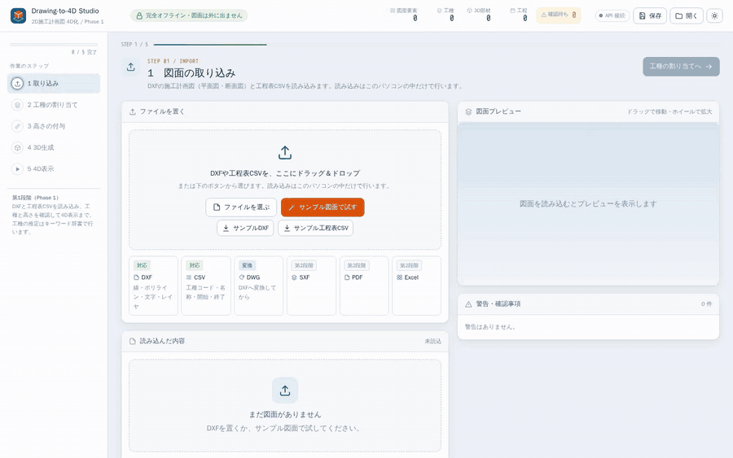
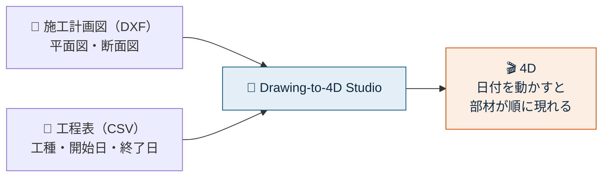
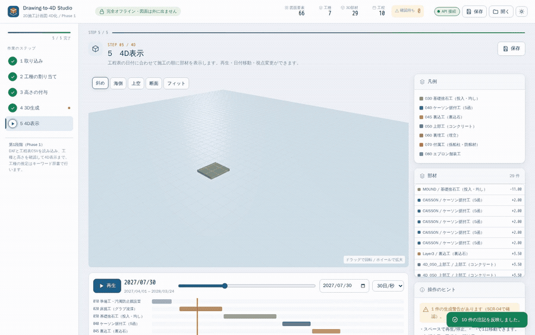
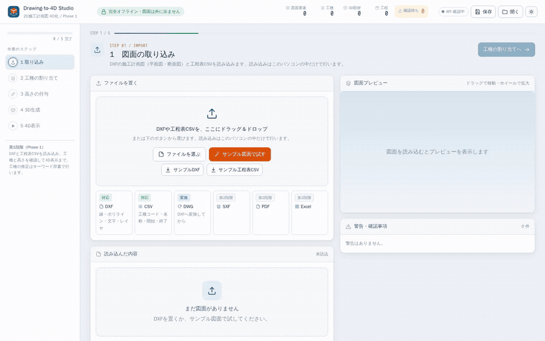
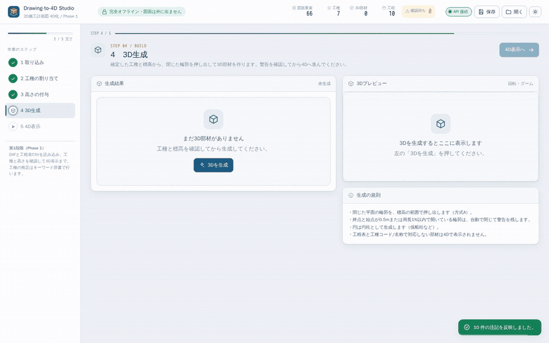
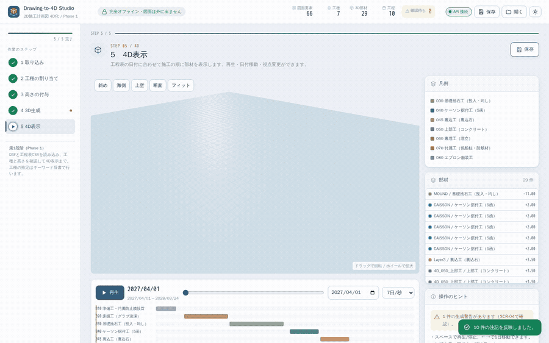
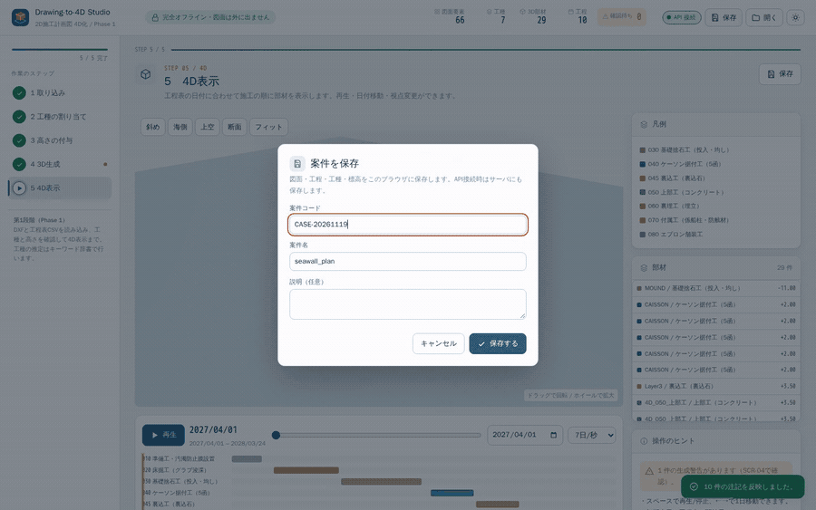

<h1 align="center"></h1>

<p align="center"><b>2Dの施工計画図（DXF）と工程表（CSV）から、「どの順番で建つか」が伝わる4Dをつくる</b></p>

<p align="center">👷 現場管理のための道具 ｜ 🧭 かんたん5ステップ ｜ 🔒 図面は外に出ません ｜ 🎬 ブラウザだけで動きます</p>

<p align="center"></p>

<p align="center"><sub>▲ 実際の画面を録画したものです（サンプル図面・架空）</sub></p>

<p align="center">
  <a href="#try">🚀 すぐ試す</a> ・
  <a href="#what-is-4d">🎬 4Dってなに？</a> ・
  <a href="#screen-guide">🖱️ 画面の見かた</a> ・
  <a href="#faq">❓ よくある質問</a> ・
  <a href="#for-developers">🛠️ 開発者向け</a>
</p>

<p align="center"><sub>最終更新: 2026-11-19 ／ Phase 1（試作版）</sub></p>

---

## ⏱️ 30秒でわかる

| 項目 | 内容 |
| :-- | :-- |
| 🎯 **これは何？** | 平面図と工程表を組み合わせて、**工事が進む様子を3Dで再生**できるようにする道具です |
| 👥 **だれのため？** | 現場管理の社員（若手・新任の方も）、協力会社、発注者との打合せに出る方 |
| ✨ **なにがうれしい？** | 「この順番で建つ」を**言葉ではなく映像で**共有できます。朝礼・打合せ・引き継ぎが短くなります |
| 🔒 **データは？** | 図面は**ブラウザの中だけ**で処理します。外部のAIやサーバへ図面を送りません |
| ⚠️ **注意** | 数量の拾い出しや干渉チェックには使えません。**説明・合意形成のための概略**です |

---

<a id="what-is-4d"></a>

## 🎬 4Dってなに？

**3D（形）＋ 時間（工程）＝ 4D** です。
3Dは「完成した姿」しか見せられません。4Dは「**いつ、どこから、どの順で建つか**」を見せられます。





> 💡 上の映像は、日付スライダーを動かして**基礎 → ケーソン → 上部工**が順に現れるところです。
> 工程表の日付と連動しているので、「4月には何ができているはずか」が一目で分かります。

---

## 💡 現場でどう使う？（うれしいこと）

| 場面 | 使い方 | 効果 |
| :-- | :-- | :-- |
| 🌅 **朝礼・安全朝礼** | 今日・今週の施工範囲を4Dで再生 | 「今日はどこを作るか」の共通認識が一瞬で揃う |
| 🤝 **協力会社との打合せ** | 工種ごとの順番・重なりを確認 | 手戻りや「聞いていない」を減らせる |
| 👶 **若手・新任への説明** | 完成形ではなく**過程**を見せる | 図面を読む前の「全体像」をつかめる |
| 📝 **発注者への報告** | 日付を指定して途中の姿を表示 | 進捗の説明が具体的になる |
| 🔁 **引き継ぎ** | 保存した案件を開く | 前回の検討をそのまま再現できる |

> ⚠️ **使わない場面**: 数量の拾い出し、鉄筋の干渉チェック、施工計画の精査。
> Phase 1は**概略の説明用**です。詳細な検討は従来どおり図面と積算で行ってください。

---

<a id="try"></a>

## 🚀 3分で試す

### 1. 画面を開く

```
🌐 https://d4d.mirai-dx-platform.com/
```

> 🔑 社内の許可されたメールアドレス（`mirai-const.co.jp` など）でログインします。ログインコードがメールに届きます。

### 2. サンプルで試す

**「✨ サンプル図面で試す」** ボタンを押すだけです。
架空の護岸工事（20レイヤ・66要素・10工程）が読み込まれます。

### 3. 5ステップを進む

| ステップ | 画面 | やること |
| :-- | :-- | :-- |
| **1** 📤 | 図面の取り込み | DXFと工程表CSVを置く（またはサンプル） |
| **2** 🗂️ | 工種の割り当て | レイヤごとに「これは何の工事か」を確認 |
| **3** 📏 | 高さの付与 | 天端・底面の高さを決める |
| **4** 🧊 | 3D生成 | 押し出して3D部材を作る |
| **5** 🎬 | 4D表示 | 再生・日付移動・視点変更 |

各画面の右上にある **青いボタン（次のステップへ →）** を押していけば、最後まで進めます。

---

<a id="screen-guide"></a>

## 🖱️ 画面の見かた（アイコンの意味）

画面の左側に、いつも5つのステップが並んでいます。

| アイコン | 意味 | 状態の見かた |
| :-- | :-- | :-- |
| 📤 | 取り込み | ✅ 緑のチェック＝完了、青い枠＝いまここ |
| 🗂️ | 工種の割り当て | 🟠 オレンジの点＝未確定が残っている |
| 📏 | 高さの付与 | 🟠 オレンジの点＝高さの不整合がある |
| 🧊 | 3D生成 | 🟠 オレンジの点＝生成の警告がある |
| 🎬 | 4D表示 | ▶️ 最後のステップ |

- 上部の **`n / 5 完了`** のバーで、どこまで進んだかが分かります。
- 画面上部の数字（📐図面要素・🗂️工種・🧊3D部材・📅工程・⚠️確認待ち）は、**いまの状態の集計**です。

---

## 🗂️ 工種の割り当て（いちばん大事な画面）

ここだけは、**人の目で確かめる**必要があります。



### 「確からしさ」メーターの読み方

| 表示 | 意味 | どうする |
| :-- | :-- | :-- |
| 🟢 **80%以上** | レイヤ名に工種コードが入っている等、ほぼ確実 | まとめて確定してOK |
| 🟠 **50〜79%** | 名前から推定。だいたい合っていそう | **必ず目で確認**してから確定 |
| 🔴 **50%未満** | 推定があいまい | **必ず手で選ぶ** |

- **「⚡ 信頼度80%以上を一括確定」** を押すと、緑の行をまとめて確定できます。
- **「未確定のみ表示」** にチェックすると、確認が必要な行だけに絞れます。
- 手で工種を選ぶと、そのレイヤ名が**辞書に登録**され、次回から同じ書き方の図面で自動的に当たるようになります（同じ現場の繰り返しに効きます）。
- 未確定のまま次へ進むと、その行は**3D化されません**（確認ダイアログが出ます）。

---

## 📏 高さの付与（かんたんに）

平面図には「高さ」がありません。そこで、**断面図の標高注記**を候補として出します。

1. 右側の「📐 断面の標高注記」に候補が並びます（例: `ケーソン 天端 +2.0`）。
2. **「すべて反映」** を押すと、対応する工種へ自動で入ります。
3. 足りない分は、表の **天端 (m) / 底面 (m)** に直接入力します。
4. **進行方向**（延長方向に伸ばす／1つずつ据える／下から積み上げる／開始日に表示）を選びます。

> ✅ 3D化する工種は「3D」のチェックで選べます。準備工・片付けなど立体を持たないものは、最初から外れています。

---

## 🧊 3D生成のしくみ（やさしく）

Phase 1の3Dは、**平面の輪郭を上に押し上げる方式（方式A）** です。

- 🧱 閉じた輪郭 → 押し出して立体に（桟橋・ケーソンなど）
- ⭕ 円 → 円柱に（係船柱など）
- ⚠️ 輪郭が少し開いている場合は、自動で閉じて**警告**を残します
- 🚫 工程表と名前が対応しない工種は、4Dで表示されません（警告でお知らせします）

警告が出ても、**確認して問題なければ先に進めます**。警告は「どのレイヤが、なぜ」まで出ます。



---

## 🎞️ 4D表示の使い方

| 操作 | 方法 |
| :-- | :-- |
| ▶️ 再生／停止 | `再生` ボタン、または **スペースキー** |
| 📅 日付を動かす | スライダー、または **← → キー**（1日ずつ） |
| 🔍 視点を変える | 斜め／海側／上空／断面 ボタン、ドラッグで回転、ホイールで拡大 |
| 🎨 工種を強調 | 右側の「凡例」をクリック |
| 🔎 部材を選ぶ | 右側の「部材」一覧をクリック |
| ⏩ 再生スピード | 1日/秒・2日/秒・7日/秒・30日/秒 |

下のガントチャート（横棒）をクリックすると、その工程の開始日へ飛びます。
日付の縦線が**今どこを見ているか**を示します。

画面右上の丸いボタンで、**暗い画面（ダークテーマ）**に切り替えられます。夜間作業の打合せや、暗い部屋での投影に向いています。



---

## 💾 保存と再開

| 保存先 | いつ使える | 注意 |
| :-- | :-- | :-- |
| 💻 **このブラウザ** | いつでも | 同じパソコン・同じブラウザで開けます（約5MBまで） |
| ☁️ **サーバ** | 「API 接続」と表示されているとき | 別の端末でも開けます |

- 右上の **保存** から案件コードと案件名を付けて保存します。
- **開く** で、保存した案件一覧から選べます。
- 大きな図面はブラウザの保存容量を超えることがあります。その場合は再取り込みしてください。



---

<a id="faq"></a>

## ❓ よくある質問

<details>
<summary><b>Q. 図面は外部に送られますか？</b></summary>

いいえ。DXF・CSVの解析、工種の推定、3D生成、4D再生は**すべてブラウザの中で**行います。
サーバへ送るのは「保存」を押したときの案件データだけです。

</details>

<details>
<summary><b>Q. 対応しているファイルは？</b></summary>

- ✅ **DXF**（施工計画図。線・ポリライン・円・文字・レイヤ）
- ✅ **CSV**（工程表。工種コード・名称・開始日・終了日）
- ⏭️ DWG は DXF に変換してから使います
- ❌ SXF / PDF / Excel は第2段階で対応予定です

</details>

<details>
<summary><b>Q. AIが工種を判断しているのですか？</b></summary>

いいえ。Phase 1は**キーワード辞書**（レイヤ名のルール）で推定しています。
だから結果が読めて、間違えたら直せます。直した内容は辞書に学習されます。

</details>

<details>
<summary><b>Q. 3Dが真っ白／表示されない</b></summary>

- ブラウザは **Chrome / Edge の最新版** をお使いください（WebGL2が必要です）
- リモートデスクトップ経由だと3Dが無効なことがあります。その場合はローカルで開いてください
- それでも出ないときは「上空」や「斜め」を押すと復帰することがあります

</details>

<details>
<summary><b>Q. インストールは必要ですか？</b></summary>

不要です。ブラウザで開くだけです。
オフラインで使いたい場合は、開発者が `pnpm build` で作る**単体のHTML**（`dist/standalone/index.html`・約736KB）を開くと、ネット接続なしで動きます。

</details>

<details>
<summary><b>Q. 4Dの日付と実際の工程がずれる</b></summary>

工程表CSVの日付をそのまま使います。工程表を直してから読み込み直してください。

</details>

---

## 📚 用語集（はじめての方へ）

| ことば | やさしい説明 |
| :-- | :-- |
| **DXF** | CADの図面ファイル形式のひとつ。多くのCADから書き出せます |
| **CSV** | 表計算ソフトで開ける、カンマ区切りの表。工程表に使います |
| **4D** | 3Dに「時間（工程）」を足したもの。建つ順番が見えます |
| **工種** | 工事の種類（例: 基礎捨石工、ケーソン据付工、上部工） |
| **レイヤ** | 図面の重ねシート。線や文字が「どの層」にあるかで整理されています |
| **標高** | 高さ。天端（いちばん上）と底面（いちばん下）で立体の範囲を決めます |
| **押し出し** | 平面を上に持ち上げて立体にすること（方式A） |
| **ガントチャート** | 工程を横棒で表した図。どの作業がいつか一目で分かります |

---

## 🔒 大切な約束（安全・品質）

1. 🔐 **図面は外に出さない** — ブラウザ内で処理。外部AI・外部サービスへ送信しません。
2. 🙋 **推定は下書き、確定は人** — 自動で当てた工種は必ず人が確認します。
3. 🧪 **サンプルは架空** — リポジトリに入っている図面・工程表はすべて架空のものです。実データ・社外秘は入れないでください。
4. 📝 **記録を残す** — 保存した案件には案件コードと名称を付けてください。

---

<a id="for-developers"></a>

## 📚 研修・配布資料

新人研修や現場での説明に、そのまま使える資料を用意しています。

| 資料 | 形式 | 使いどころ |
| :-- | :-- | :-- |
| 📄 **操作ガイド（1枚）** | [PDF](docs/manual/quick-guide.pdf) ／ [HTML](docs/manual/quick-guide.html) | A4 1枚。印刷して現場・事務所に配る |
| 🎞️ **新人研修スライド（12枚）** | [PDF](docs/training/slides.pdf) ／ [HTML](docs/training/slides.html) | 60分の研修。HTMLは ←→ キーで進行、PDFは投影用 |

- 🖨️ 操作ガイドは **A4 1ページ**に収めています（印刷そのまま配布可）
- 🖥️ スライドHTMLは**ブラウザで開くだけ**（`←` `→` / スペースで進行、`Home`/`End` で先頭・末尾）
- 🎥 どちらも**架空サンプル**の画面のみを使用

---

## 🛠️ 開発者向け

<details>
<summary><b>構成・セットアップ・検証コマンドを開く</b></summary>

### 構成

```
src/core/     DXF・CSV・工種推定・標高・3D部材・タイムライン（純粋TS）
src/web/      Vite + TypeScript のSPA（three.js）／画面・アイコン・アニメーション
src/api/      Fastify + pg のローカルAPI
db/           PostgreSQL migration
scripts/      DB・E2Eサーバ・secret-scan・preview検証
tests/        unit / integration / e2e
deploy/       CIテンプレート、systemd／Cloudflare Tunnel 設定
docs/         project / design / 運用文書 / 画面証拠
```

### 必要環境

- Node.js 22 以上（実測 22.22.3）
- pnpm 12 以上（実測 12.21.0）
- PostgreSQL 16 以上（実測サーバー 16.15）

### セットアップ

```bash
pnpm install

createdb d4d_studio
createdb d4d_studio_test

pnpm db:migrate && pnpm db:seed && pnpm db:verify

pnpm dev   # API :8790 / Web :5179
```

### 主なコマンド

| コマンド | 内容 |
| :-- | :-- |
| `pnpm typecheck` | 型チェック（web / api / scripts） |
| `pnpm lint` | ESLint（警告0） |
| `pnpm test` | 単体テスト |
| `pnpm test:integration` | 結合テスト（`d4d_studio_test`） |
| `pnpm test:e2e` | Playwright E2E |
| `pnpm build` | Web + Standalone ビルド |
| `pnpm secret-scan` | 秘密情報の混入チェック |
| `pnpm verify:preview` | Preview の到達性・Access・CSP を実測 |

### テスト（2026-11-19 実測）

| 種別 | 件数 | 結果 |
| :-- | --: | :-- |
| 単体（unit） | 37 | ✅ 成功 |
| 結合（integration） | 10 | ✅ 成功 |
| E2E（Playwright） | 9 | ✅ 成功 |

### Preview

```
https://d4d.mirai-dx-platform.com  →  Cloudflare Access  →  Tunnel  →  127.0.0.1:8792
```

- `/healthz` のみ Access をバイパス（状態のみ、データなし）
- 配備: `pnpm deploy:preview`（再ビルド・API再起動・到達性確認）
- 復旧手順: [`docs/deployment.md`](docs/deployment.md)

### セキュリティ

- CSP `default-src 'self'`、`X-Frame-Options: DENY`、`nosniff`
- 図面・工程表はブラウザ内処理。サーバ保存は任意
- 秘密情報はリポジトリ・ログ・Seed・画面に置かない（`pnpm secret-scan`）

### 既知の制限

- 3Dは方式A（平面の押し出し）のみ。方式B（断面の押し出し）は将来対応
- 対応形式は DXF と工程表CSV のみ（SXF/PDF/Excel/DWG直接は第2段階）
- 4Dは概略。数量・干渉確認には使えません
- ブラウザ保存は約5MBまで
- 複数ユーザー同時編集・本番運用は対象外

</details>

---

## 📖 もっと詳しく

| 文書 | 内容 |
| :-- | :-- |
| [`docs/project/01-mvp-scope.md`](docs/project/01-mvp-scope.md) | Phase 1 の対象範囲 |
| [`docs/design/d4d-studio-design.html`](docs/design/d4d-studio-design.html) | 画面設計（正） |
| [`docs/project/03-design.md`](docs/project/03-design.md) | 実装との差異・UI改善の記録 |
| [`docs/test.md`](docs/test.md) | テスト方針と結果 |
| [`docs/deployment.md`](docs/deployment.md) | 配備と復旧 |
| [`docs/limitations.md`](docs/limitations.md) | 既知の制限 |
| [`docs/security.md`](docs/security.md) | セキュリティ方針 |

---

<p align="center"><b>🏗️ 図面を、現場の共通言語に。</b></p>

<p align="center"><sub>Drawing-to-4D Studio ／ Phase 1 ／ 社内利用（private）</sub></p>
